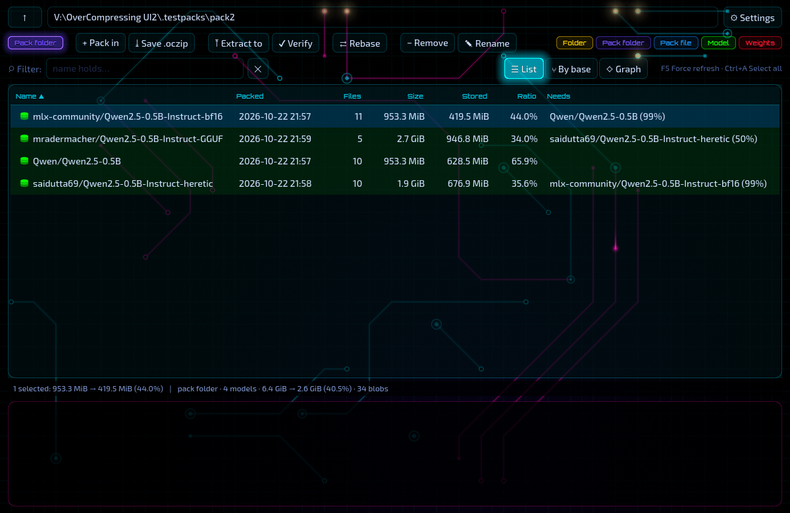
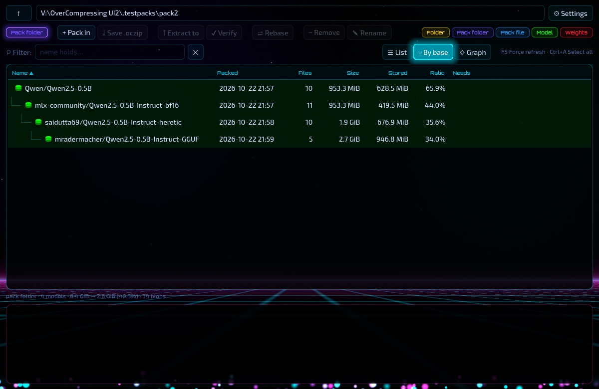
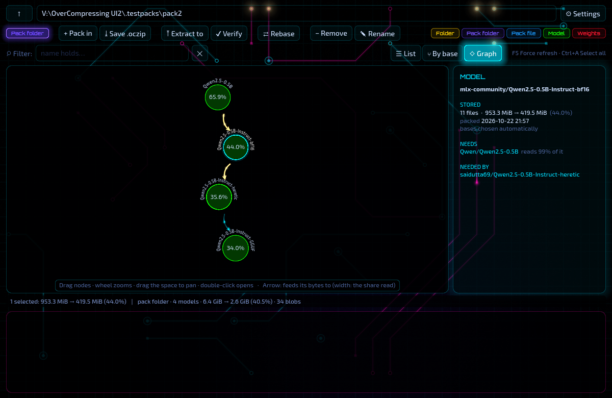
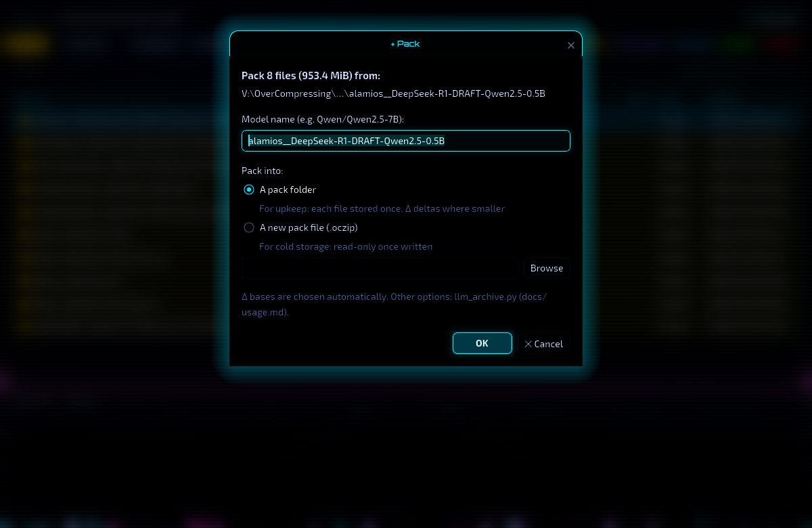
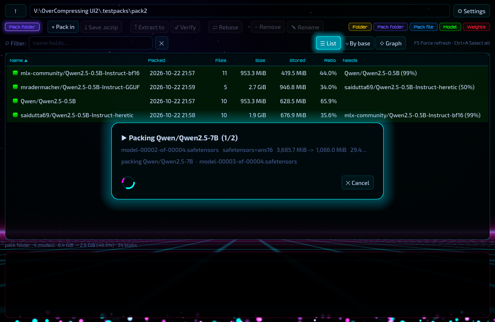

# OverCompressing UI2

A window for [OverCompressing](..) (`tools/llm_archive.py`, the lossless archiver for open-weight
LLMs) built on the **Godot 4.7 engine** (C#) instead of a GUI toolkit. It does everything the original Tkinter window
does, with the same words, and runs the same tool underneath: every change is `llm_archive.py` in a child process,
every listing is `list --json`. The look is **cyber + neon**, made of what only an engine gives cheaply: HDR glow,
a live circuit board behind the panels (signals run the traces; a pad breathes warm white when one arrives), a
neon cursor that drags its own wake, a graph of what needs what, a frosted veil, tweened motion, an intro and an outro,
synthesized sounds.

用遊戲引擎（Godot 4.7，C#）重做的 OverCompressing 視窗：功能與原本的 Tkinter 視窗一一對應，底層同樣呼叫
`llm_archive.py`。主題是 cyber + neon：HDR 泛光、程序生成的電路板背景（訊號沿走線傳遞，抵達節點時焊點以暖白呼吸一下）、霓虹游標與拖曳殘影、
模型相依關係圖、毛玻璃遮罩、補間動畫、開場與收場動畫、程式合成的提示音；全部可在 ⚙ Settings 關掉。



| | |
|---|---|
|  |  |
|  |  |

## Get it

Needs Windows 10 x64 or later, a GPU with Vulkan or Direct3D 12 for the glow (the window still runs on OpenGL 3,
without it), and an OverCompressing checkout or portable copy with its Python (the checkout's `.venv`, or the copy's
own). The built window is a **release asset**, `OverCompressingUI-<version>-win64.zip` (the exe and its `data_*`
folder, about 200 MB unzipped; it is not in the repository, being over GitHub's size limit for a file). Unzip it
anywhere: the window looks for `tools\llm_archive.py` in its own folder and three folders up (so `OCUI2\dist\` inside
the checkout works as it is), in `OVERCOMPRESSING_HOME`, in a pack's `_kit`, and in `V:\OverCompressing`; ⚙ Settings
lets you point it elsewhere and checks the choice, and holds the switches for the effects and the sounds.

## Build it

Needs the .NET SDK 8 or later. The engine is fetched once (the editor and the Windows export templates, about 300 MB):

```powershell
powershell -ExecutionPolicy Bypass -File engine\get_engine.ps1
powershell -ExecutionPolicy Bypass -File run.ps1 V:\packs          # or a folder, or a .oczip
powershell -ExecutionPolicy Bypass -File build.ps1                 # dist\OverCompressingUI.exe + the release zip
```

## What is where

- `OverCompressingUI/` — the Godot project; `src/Core` (the tool bridge, no engine types) and `src/UI` (the window,
  the effects in `Fx.cs`, the shaders in `assets/shaders`).
- `docs/original-project-notes.md` — what the port turned up about the original project (nothing there was changed).
- `docs/third-party.md` — the engine and the fonts (Orbitron, Exo 2, Share Tech Mono; all OFL).
- `AGENTS.md` — how it is built and checked, how it talks to the tool, the conventions, the decisions behind the look.

License: MIT, as the original; the fonts under their own OFL.
