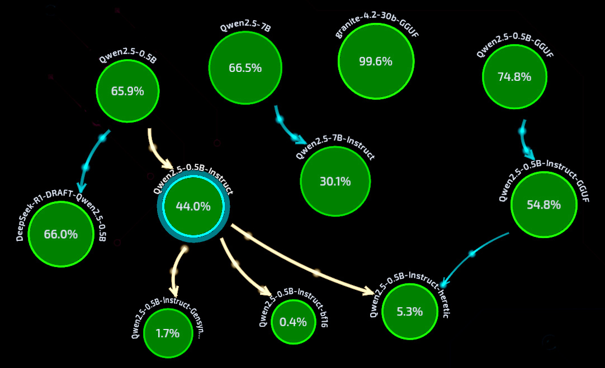
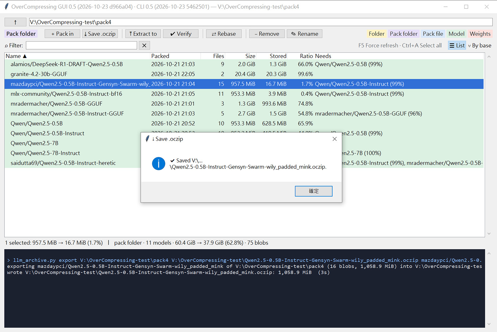
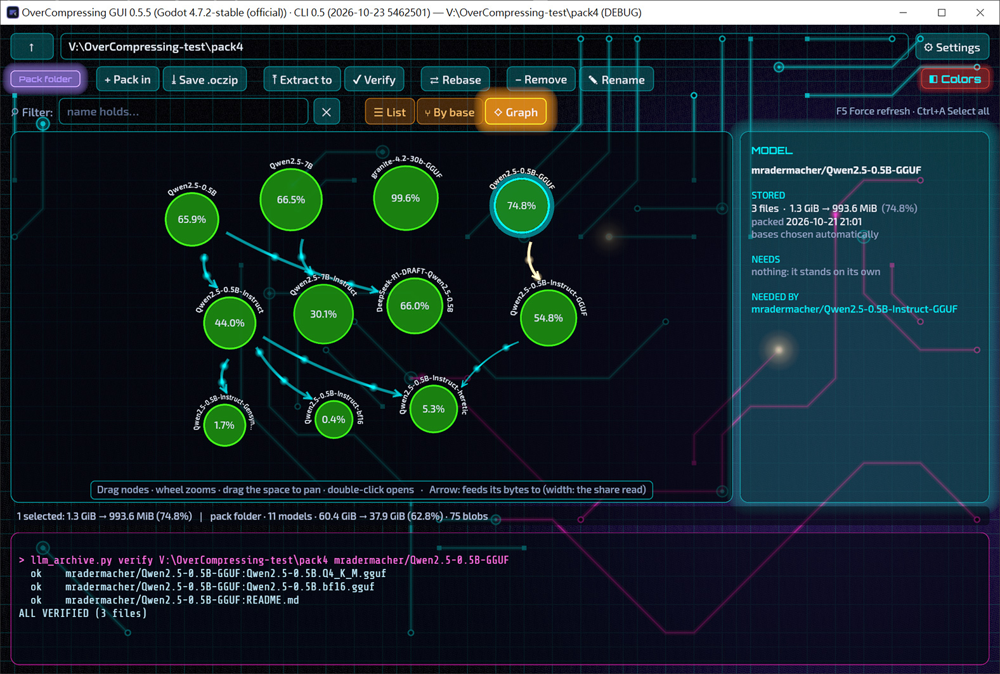

# OverCompressing

**Lossless archiving for open-weight LLMs — every file restored bit for bit, at half the size or less.**
**開源大型語言模型的無損歸檔工具：每個檔案都能逐位元還原，體積減半甚至更小。**

[](LICENSE)


Model weights hardly compress with zip or zstd, and quantizing them loses information. OverCompressing keeps the
original files exactly, compresses each tensor with a codec suited to it, and stores fine-tunes as deltas against
their base model. A portable copy of the tool (its own Python, packages and docs, in one folder) can travel with each
pack, so it can be restored without internet access.

模型權重用 zip、zstd 幾乎壓不動，量化又會失真。OverCompressing 完整保留原檔，對每個 tensor 用最合適的方式壓縮，
並把微調模型存成「和 base 的差異」。可攜版工具（自帶 Python、套件與文件的單一資料夾）可以跟著 pack 一起保存，沒有網路也能還原。

---

## Results at a glance / 實測摘要

| what | result |
|---|---|
| one BF16 model (Qwen2.5-0.5B / 7B) | **66.4 %** of the original (zstd -19: 75.9 %; entropy floor ≈ 66.2 %) |
| official Instruct as a delta of its Base | **44 %** (0.5B), **30 %** (7B) |
| community fine-tunes (RL, abliteration, re-uploads) | **0.1 – 5 %** |
| F16 GGUF against a BF16 base · vocab-extended draft model | **44 %** · **30 %** |
| test archive: 6 repos, 34.3 GiB | **17.2 GiB (50.1 %)** |
| speed, 8 cores: pack / restore a 7B BF16 model | **≈ 1.5 min / 30 s** (a 7B fine-tune as a delta: ≈ 5.5 min to pack) |

All results are verified by decoding from disk and matching the original SHA-256 (for these tests, also the
hashes Hugging Face publishes).



A real pack, 11 models: 60.4 GiB of files in 37.9 GiB (drawn by [OCUI2](#ocui2--第二視窗)). Each arrow runs from a
base to a model stored as a delta against it; each circle is what that model takes, as a share of its own size.
Qwen2.5-0.5B-Instruct (selected) reads 99 % of Qwen2.5-0.5B and takes 44.0 % (953.3 MiB → 419.5 MiB); three community
fine-tunes are stored against it in turn, at 0.4 – 5.3 %. A quantized GGUF with no relative in the pack
(granite-4.2-30b-GGUF) stands on its own and barely shrinks (99.6 %).

→ **[Benchmarks](docs/benchmarks.md)**

## How it works / 原理

- **Per tensor.** safetensors and GGUF files are parsed. Float tensors are split into byte planes so that the
  exponents sit together (the byte-grouping idea of [ZipNN](https://github.com/zipnn/zipnn)) and are entropy-coded
  with zlib's Huffman coding; quantized tensors and metadata go to zstd. The whole tool is Python on NumPy, zlib and
  zstd: no compiled code of its own, no PyTorch.
- **Deltas with the base as predictor.** A fine-tune is stored as residuals against its base, coded by **ans16**, a
  context-modelled rANS coder written for this project. No neural network is trained: the base model *is* the
  predictor.
- **Matched by tensor name** across file names, shardings, orders, float dtypes (BF16/F16/F32) and vocabulary sizes.
- **Base chosen automatically.** Each file is trial-coded against every matching model already in the pack and
  uses the one that compresses it best, or none; `--base` overrides.
- **Verified at every step**; identical files are stored once. Damage is detected; for repair, pick a protection
  scheme ([docs/protection.md](docs/protection.md)).

→ **[How it works](docs/principles.md)**

## Scope / 適用範圍

| works well | limited |
|---|---|
| BF16 / F16 / F32 / FP8 safetensors and GGUF | quantized files on their own (95–97 %) |
| families: Base → Instruct → community fine-tunes | GGUF ↔ safetensors cross-format deltas (not yet) |
| PyTorch `.bin` and other binaries (auto codec) | speed of deltas: their coder is pure NumPy (≈ 8 MB/s per core) |

→ **[Scope](docs/scope.md)**

## Quick start / 快速開始

With the Python of a portable copy (see Build), or any Python 3.13 with numpy and zstandard
(`pip install -r requirements.txt`):

```bash
python -I tools/llm_archive.py pack    models/Qwen2.5-0.5B packs --name Qwen/Qwen2.5-0.5B
python -I tools/llm_archive.py pack    models/Qwen2.5-0.5B-Instruct packs --name Qwen/Qwen2.5-0.5B-Instruct
python -I tools/llm_archive.py list    packs
python -I tools/llm_archive.py verify  packs
python -I tools/llm_archive.py restore packs Qwen/Qwen2.5-0.5B-Instruct restored
```

Get the model folders with any tool you like (OverCompressing never downloads) → pack the base → pack the fine-tune
(it finds its base in the pack by itself and is stored as a delta) → verify → restore. Every file is stored once,
named by its SHA-256 and shared by every model that has it; `remove` deletes only what no other model still needs.
Prefer a window? See [below](#the-window--視窗). Just one model in one file? `python -I tools/llm_archive.py pack models/Qwen2.5-0.5B
Qwen2.5-0.5B.oczip`. Every command can report progress and print JSON lines (`--progress`, `--json`), for scripts and
agents.

Two forms of a pack:

- **Pack folder (`ocpack.json`, `models/`, `blobs/`): for upkeep.** Add, re-pack, remove, rename or rebase models one
  change at a time.
- **Pack file (`.oczip`, the same tree in one ZIP file): for cold storage.** Made by `pack` or `export`, written once;
  copy it, shelve it. `list`, `verify` and `restore` read it as it is.

→ **[Usage](docs/usage.md)** (中英對照)

## The window / 視窗

A small window (Tkinter) does most of what the commands do: browse folders and packs, pack, extract, verify, remove,
rename, rebase, save a pack file.



What it needs to start:

- **A portable copy** (see Build) has everything: start `OverCompressing.cmd` on Windows (double-click it) or
  `./overcompressing` on Linux.
- **Your own Python 3.13**, with numpy and zstandard: `python -I tools/llm_archive_gui.py [<folder> | <pack>]`
  (`pythonw` on Windows, for no console window). It needs tkinter: python.org's Windows installer has it; on Linux a
  distribution's Python may need its Tk package (e.g. `python3-tk`). `python -I -m tkinter` opens a small test
  window when tkinter works.
- **On Linux**, a graphical desktop (X11, or Wayland with XWayland). Over SSH, use `ssh -X`, or the command line.

How to use it: [usage, "A window instead of commands"](docs/usage.md#a-window-instead-of-commands).

## Build / 建置

| platform | guide |
|---|---|
| Windows 10/11 x64 | **[docs/build-windows.md](docs/build-windows.md)** (中英對照) |
| Linux x86-64 | **[docs/build-linux.md](docs/build-linux.md)** (中英對照) |

Each guide makes a portable copy: one folder with its own CPython 3.13, numpy and zstandard (pinned, hash-checked
downloads) and the tools. Nothing is installed and no compiler is needed; agents can follow the steps as written.

## Protecting the archive / 防護與修復

OverCompressing detects damage but leaves repair to the storage: RAID, ECC, ZFS/Btrfs/ReFS, several copies, optical
ECC or tape. **[docs/protection.md](docs/protection.md)** (中英對照) compares them and lists what matters for a pack
with deltas (protect bases most, rebuild repair data after a change).

## Archive format / 歸檔格式

The on-disk format is documented byte by byte, including how to decode ans16 by hand, so archives stay readable
without this tool: **[tools/ARCHIVE_FORMAT.md](tools/ARCHIVE_FORMAT.md)**.

## Repository layout / 目錄結構

```
tools/llm_archive.py       the archiver (pack / list / verify / restore / remove / rename / rebase / export)
tools/llm_archive_gui.py   a small window (Tkinter): a pack as the list of its models, and the actions above
tools/ARCHIVE_FORMAT.md    format specification
tools/compare_tensors.py   how well a fine-tune lines up with a base
tools/test_*.py            self-tests (ans16 coder, formats, conversions)
requirements.txt           numpy and zstandard, for your own Python
requirements-*.lock        the same, pinned and hash-checked: what the build guides install
docs/                      principles, scope, benchmarks, usage, build guides, protection advice
dev/                       experiments and measurement scripts used during development
OCUI2/                     a second window, on the Godot engine (C#): its sources (see OCUI2 below)
```

## References / 參考文獻

- M. Hershcovitch et al., *Lossless and Near-Lossless Compression for Foundation Models*, 2024 —
  [arXiv:2404.15198](https://arxiv.org/abs/2404.15198) (the earliest of the IBM papers this work starts from).
- M. Hershcovitch et al., *ZipNN: Lossless Compression for AI Models*, 2024 —
  [arXiv:2411.05239](https://arxiv.org/abs/2411.05239) · code: [github.com/zipnn/zipnn](https://github.com/zipnn/zipnn)
  (byte grouping of float weights: the idea behind the byte-plane codec, implemented here independently).
- J. Duda, *Asymmetric numeral systems*, 2009 — [arXiv:0902.0271](https://arxiv.org/abs/0902.0271); and
  *ANS: entropy coding combining speed of Huffman coding with compression rate of arithmetic coding*, 2013 —
  [arXiv:1311.2540](https://arxiv.org/abs/1311.2540).
- F. Giesen, [ryg_rans](https://github.com/rygorous/ryg_rans) (64-bit interleaved rANS; public domain/CC0).
- T. Zhang et al., *70% Size, 100% Accuracy: Lossless LLM Compression for Efficient GPU Inference via Dynamic-Length
  Float (DFloat11)*, 2025 — [arXiv:2504.11651](https://arxiv.org/abs/2504.11651) (evaluated; needs a GPU to decode).
- DEFLATE, [RFC 1951](https://www.rfc-editor.org/rfc/rfc1951) (zlib); Zstandard, [RFC 8878](https://www.rfc-editor.org/rfc/rfc8878).

## Development / 開發與驗證

This program was developed by Claude and verified by GPT6, which tested every change independently (functional,
security and window tests, mainly on Linux) and reported back.

本程式由 Claude 開發，由 GPT6 驗證：每次修改都由 GPT6 獨立測試（功能、安全與視窗測試，主要在 Linux 上）並回報結果。

## OCUI2 / 第二視窗

A second window for the same tool, built on a game engine (Godot 4.7, C#): a live circuit board behind the panels,
neon glow, a graph of what needs what, synthesized sounds. An archiver needs none of this; the author was clearly out
of their mind. It does what the window above does, with the same words, and runs the same `tools/llm_archive.py`
underneath. Windows 10/11 x64.



It needs the archiver with its Python (a checkout with `.venv`, or a portable copy: see Build); put the window in
`OCUI2\dist\` of the checkout and it finds the tool by itself, or point ⚙ Settings at it. Two ways to get it:

- **Build it yourself (recommended).** Ask your AI assistant to build it by [OCUI2/AGENTS.md](OCUI2/AGENTS.md), or do
  it by hand: install the .NET SDK 8 or later, then, in `OCUI2\`:

  ```powershell
  powershell -ExecutionPolicy Bypass -File engine\get_engine.ps1   # the Godot engine, once (checked against its SHA-512 sums)
  powershell -ExecutionPolicy Bypass -File build.ps1               # dist\OverCompressingUI.exe and the release zip
  ```

- **Or download the built window**: `OverCompressingUI-<version>-win64.zip` from
  [Releases](https://github.com/overdoingism/OverCompressing/releases); unzip it anywhere. **At your own risk:** the
  exe is not signed and Windows may warn about it; you are the one who decides to trust a downloaded program.
  Building it yourself means running only what you can read.

More: [OCUI2/README.md](OCUI2/README.md).

## License / 授權

MIT — see [LICENSE](LICENSE). Third-party components and their licenses (numpy BSD-3, zstd BSD-3/GPL-2, CPython
PSF with zlib, python-build-standalone MPL-2.0) are listed in
**[THIRD_PARTY_NOTICES.md](THIRD_PARTY_NOTICES.md)**.
